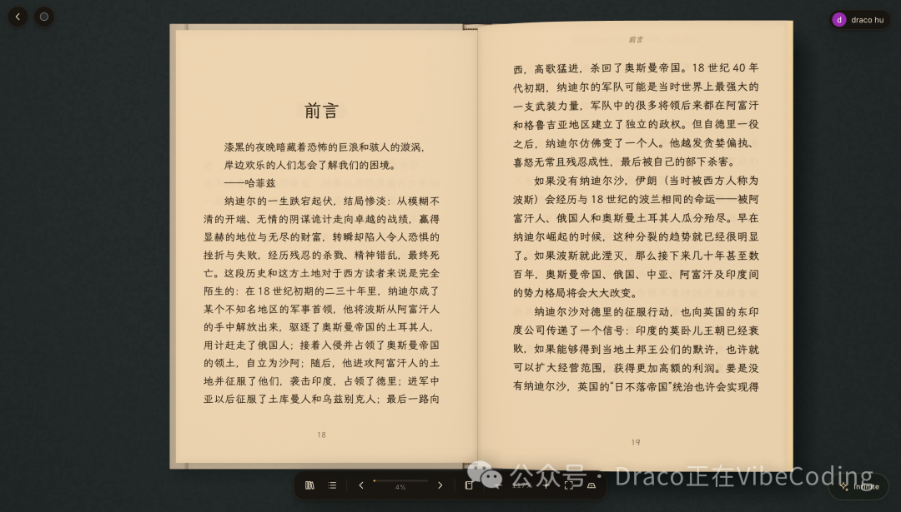
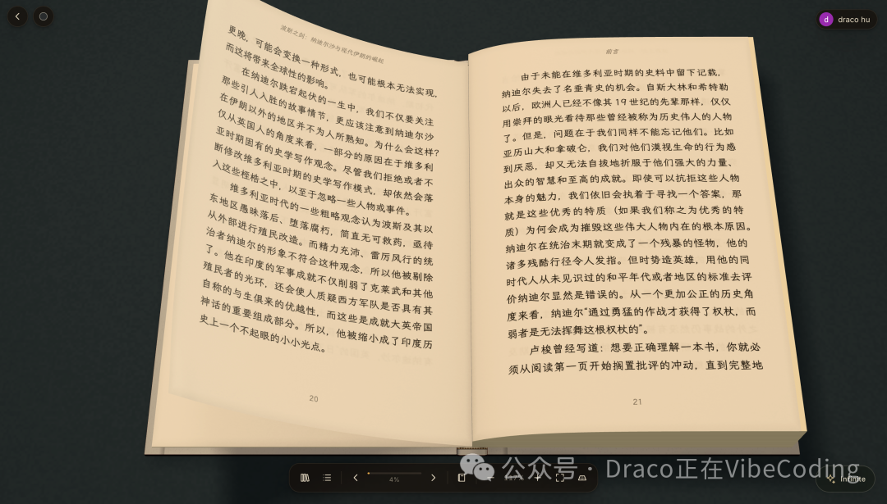
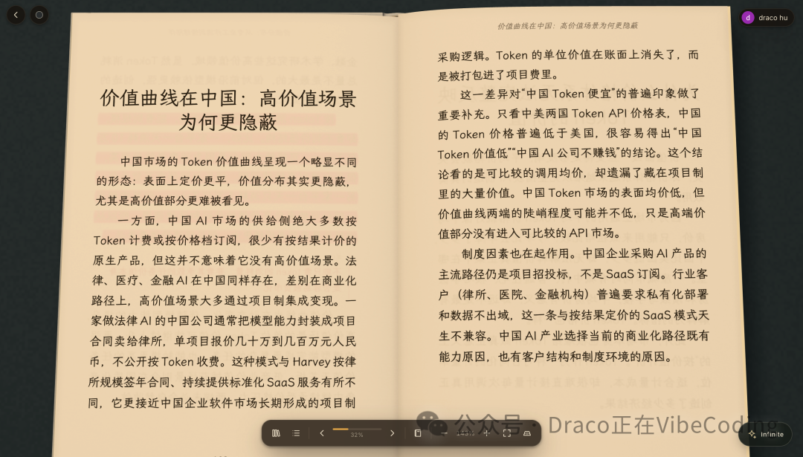
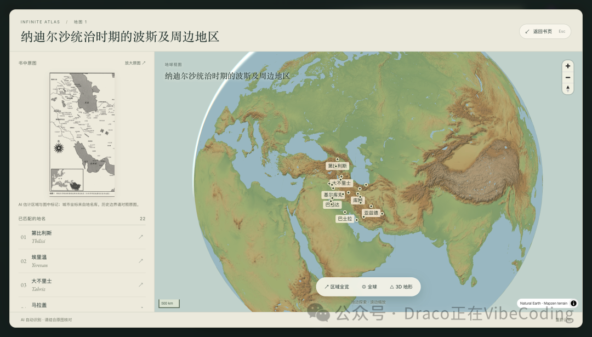
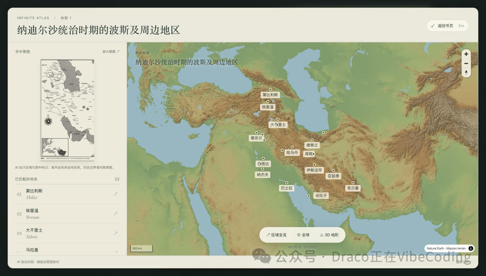
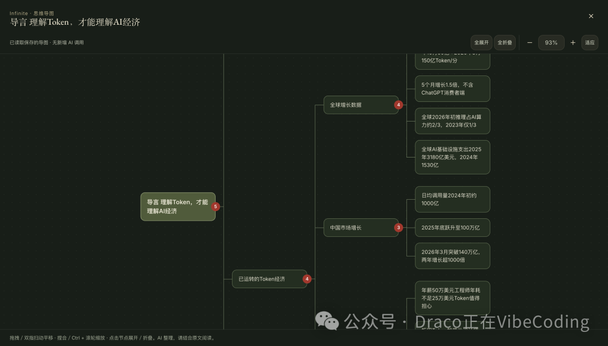
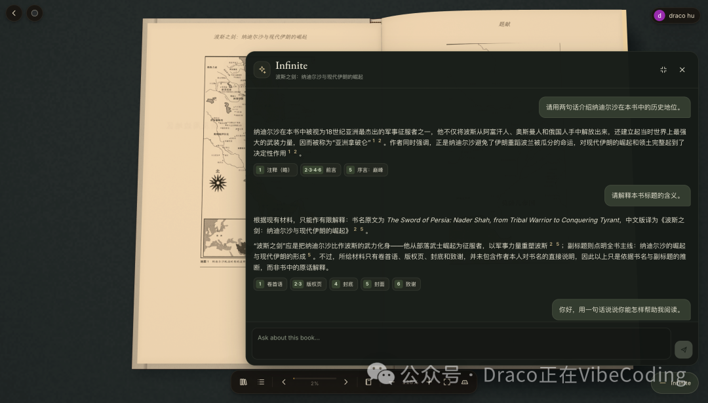
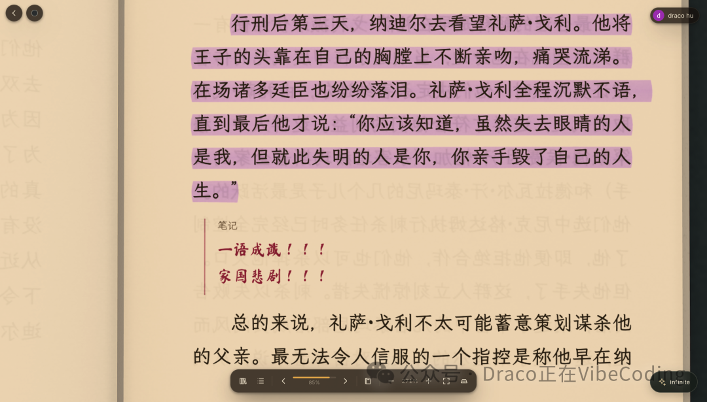
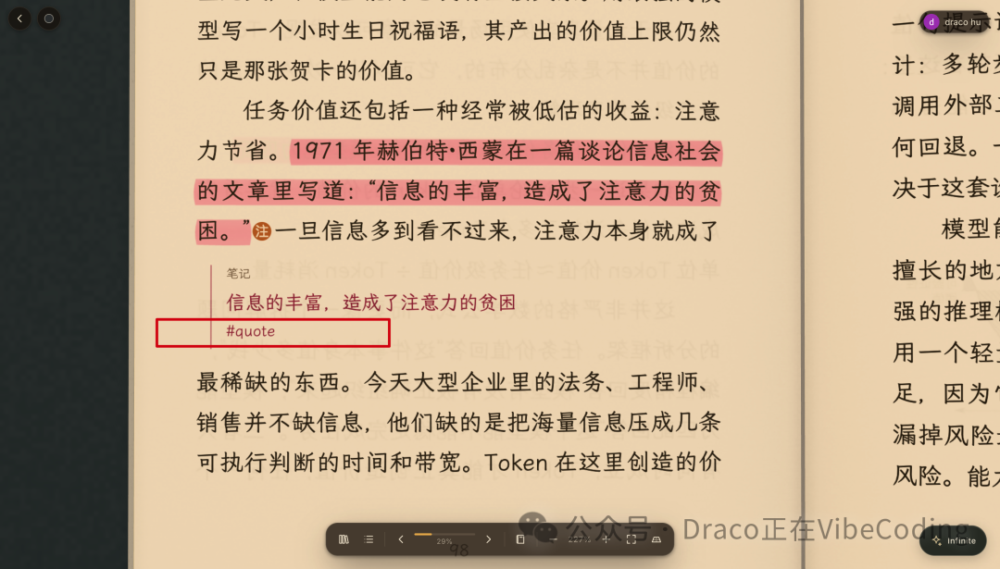
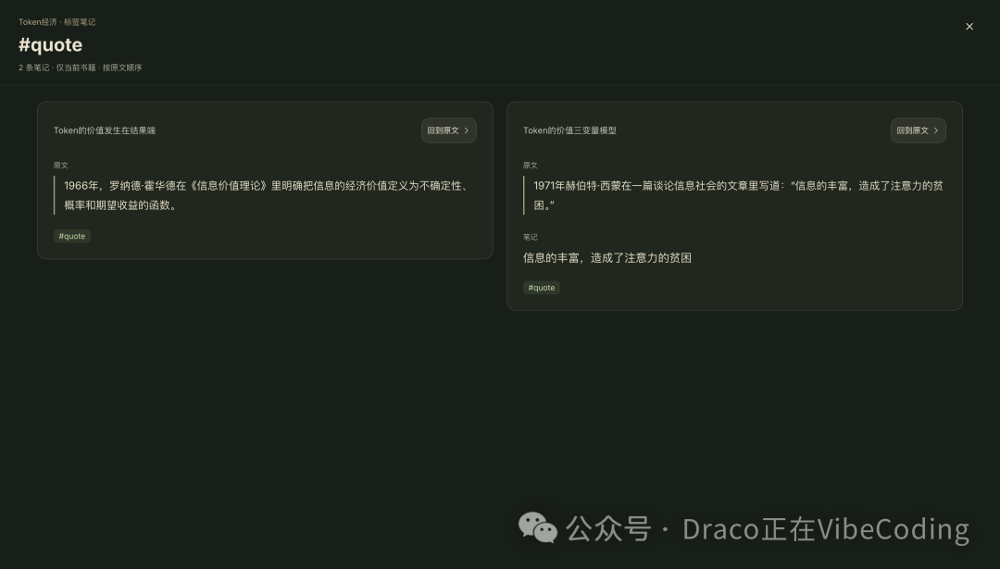

# 我在开发全世界最好的电子书阅读器

> 来源：微信公众号「**Draco正在VibeCoding**」，原创，2026-10-30 18:57 发布（北京）。
> 原文链接：<https://mp.weixin.qq.com/s/AA3UeIBUYrJWwMr-dcy2AQ>
> 抓取方式：ego-browser 真实浏览器加载后提取正文；图片已本地化至 `assets/`，原始地址与哈希见 `meta.json`。

读书这件事，我是认真的。

但我不满意当下既存的所有读书体验。

阅读纸质书体感最好，但是阅读过程中产生的各种划线和笔记无法被数字化，很多重要的参考内容由于无法数字化导致看起来很痛苦很低效，比如地图，印在纸上的黑白地图为什么不能变成3D的呢？

电子书虽然天然是数字化的，但是缺少实体书阅读时对于进度的把控感，以及很多内容的数字化依然不够完善；当然，最大的问题是，所有电子书阅读器都是别人开发的，我要添加功能是半点也不行啊 😂

所以，开发自己的电子书阅读器这件事一直都在我的计划中！

从上个周末开始，让 Opus5.5 打了个底儿把 UI 框架搭好，后续用 Codex（Codex 每天都在重制啊有没有，几乎是无限 token 的 GPT-6 Astra 开着 Ultra Fast 模式拼命薅）陆陆续续地把这个电子书阅读器的雏形勾勒出来了，以下是一些基础功能，分享给大家，大家如果有什么产品方面的建议也可以留言区告诉我：

## 1. 尽量还原纸质书阅读的体验

> 原文此处嵌有一段 00:18 的演示视频（vid: `wxv_4760759453568843777`），本次归档未下载视频文件，仅保留元数据。

**1.1 俯仰皆宜**：可以调整俯仰视角，能清晰地看到书籍当前已经阅读的部分和剩余部分的厚度

**1.2 翻页拟真**

**1.3 灵活 Zoom in/out**

## 2. 阅读增强

**2.1 书中地图可转化为可互动的 3D 地球仪形态**

**2.2 章节都可以生成思维导图（可自动全折叠/全展开）**

**2.3 提供了一个叫做 Infinite 的 AI Agent 当你的伴读书童**，底层是 Pi Agent + DeepSeek-V4.1-Flash-1017

## 3. 笔记系统

**3.1 采用了我最喜欢的 inline note 的方式**（即直接将批注放在内容中，并提供了多种手写字体和颜色的选择，指点江山激扬文字，感觉自己好似金圣叹，哈哈哈）

**3.2 提供了笔记的 `#tag` 标签系统**，方便聚类同一部书相同标签的笔记

## 后续迭代

将主要聚焦于 Agent 能力，大幅度增强这个“伴读书童”的能力：

1. 实现由 Agent 为主导（引导）的阅读体验，比如 Agent 在阅读过程中随时提出具有挑战性的问题，从而实现读书的 IPO「I（input）-P（processing）-O（output）」的完整链路；
2. 引入游戏化机制，比如完成 Agent 提出的关于书籍的挑战则获得成就激励等。

总之，如《Token 经济》阅读笔记（0）这篇笔记中所言，人要想进步得快，还是要：读好书，多读好书！

而我开发的这个电子书阅读器，就是为了“多读好书”而准备的：工欲善其事必先利其器！
