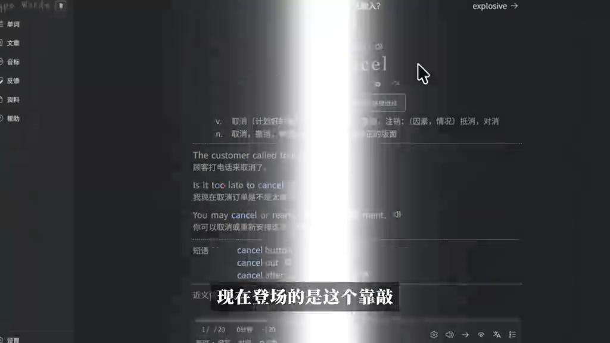
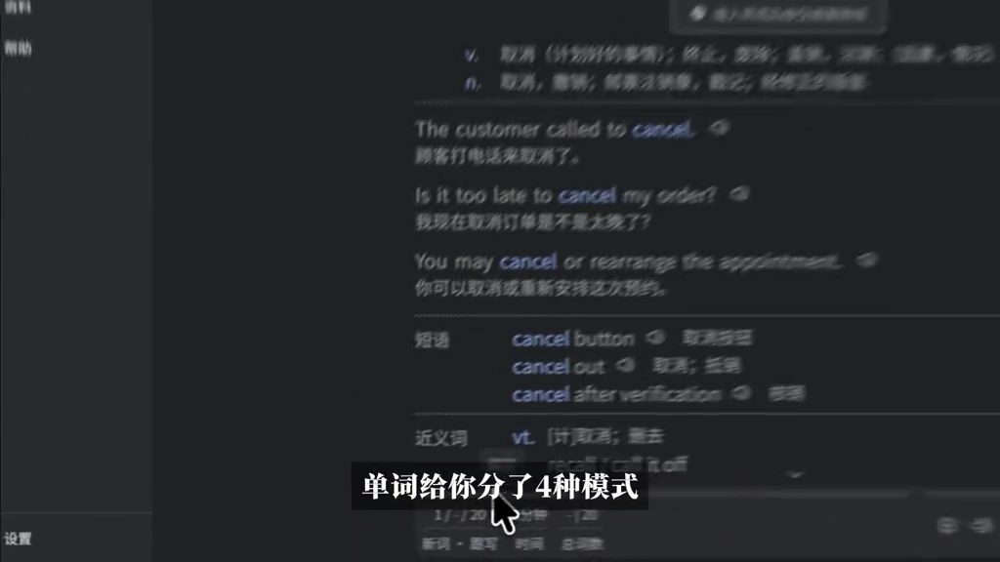
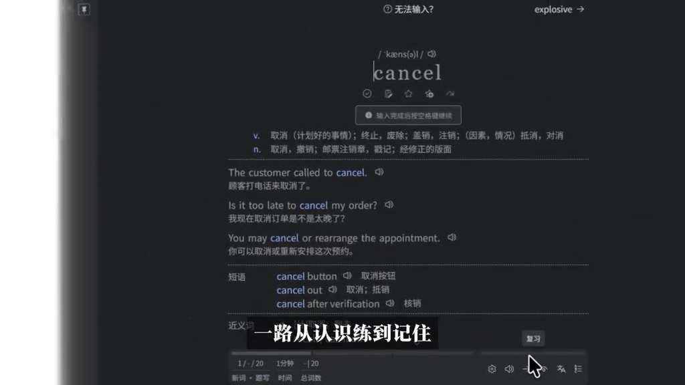
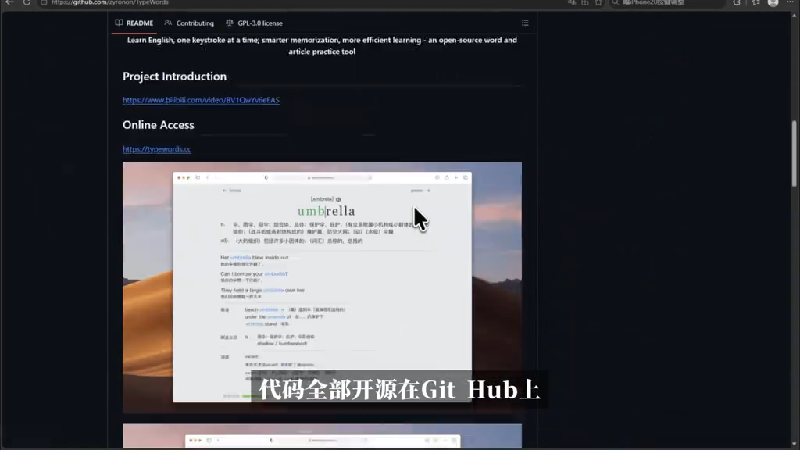
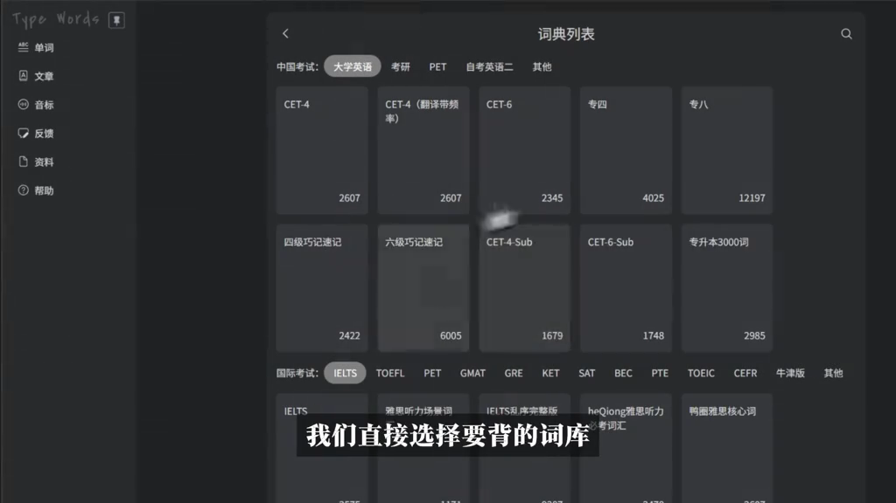
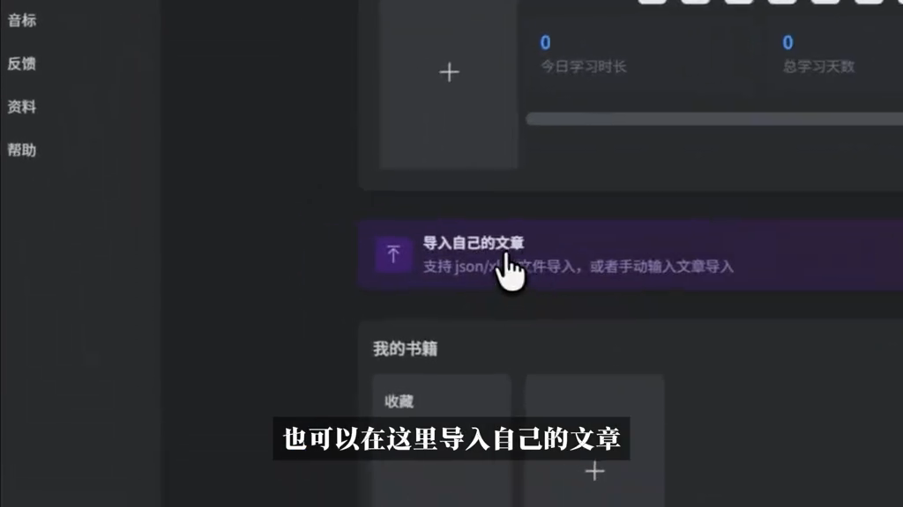

# 【012期】别再死记硬背了！打字背单词效率直接翻倍，开源免费

> 来源：抖音 @**猫吃小鱼**，发布时间 2026-11-07 19:14，时长 42.7 秒。
> 原视频：<https://www.douyin.com/video/7705386336974294291>（短链 <https://v.douyin.com/YQi85-KuskI/>）
> 抓取方式：ego-browser 打开短链跳转详情页 → 取 `<video>` 播放地址下载 MP4（本地 `assets/video.mp4`）→ ffmpeg 每 5 秒抽帧（`assets/frames/`）。
> 两轮采集：登录前抓视频/帧/页面文本；登录后补采精确互动数据、完整评论区与作者主页。
> **注意**：该视频为**无声录屏演示**（页面提示“因浏览器限制，当前为静音”），下文“字幕”均指画面内烧录的大字旁白。

## 文案（视频标题 / 描述）

> 【012期】别再死记硬背了！打字背单词效率直接翻倍，开源免费 #百度搭子 #办公就用dumate #背单词 #四级

话题标签：`#百度搭子` `#办公就用dumate` `#背单词` `#四级`

## 数据与作者（登录态采集，2026-11-09 19:22）

| 项 | 值 |
|---|---|
| 点赞 / 评论 / 收藏 / 分享 | **185 / 3 / 128 / 25** |
| 发布时间 | 2026-11-07 19:14 |
| 作者 | 猫吃小鱼（抖音号 53154217266，IP 四川） |
| 关注 / 粉丝 / 累计获赞 / 作品数 | 78 / 265 / 2397 / 18 |
| 作者主页 | <https://www.douyin.com/user/MS4wLjABAAAAeMr4PIlspcehCSK0y8Gmv57kYpV93LsYxyzh0WvcaIeaT8jbECdQsDdhE2FOTI1E> |

> 更正：抖音页面 meta description 中“已经收获了2396个喜欢”实际是**作者主页的累计获赞**（2397），不是本视频点赞数；本视频点赞以详情页计数 185 为准。

截图证据：[video-page-stats.png](assets/video-page-stats.png)（互动数据与发布时间）、[author-page.png](assets/author-page.png)（作者主页，已裁剪账号个人信息）。

## 这条视频讲了什么

一期工具安利 + 操作演示：用**百度搭子（dumate）**让 AI 把 GitHub 上的开源项目 **zyronon/TypeWords**（在线地址 <https://typewords.cc>）找出来，然后演示 TypeWords 的「打字背单词」：一个单词配 4 种练习模式，从“认识”练到“记住”；还可以按考试选词库（CET-4/6、专四专八、雅思托福……），或者导入自己的文章。片尾结论：这个开源项目值得收藏。

## 逐帧记录

> 时间码 = 帧序号 × 5 秒（ffmpeg `fps=1/5` 抽帧）。画面文字为直接抄录，可能有个别 OCR 误差。

### t≈0s · 单词卡（第 1 帧）

- 字幕：「现在登场的是这个靠敲」
- 画面：TypeWords 深色界面，词条 **cancel**，含音标、动词/名词释义、3 句中英对照例句、短语（cancel button / cancel out / cancel after verification）与近义词分区；底部进度「1 / 20」。
- 左侧栏：单词 / 文档 / 音标 / 反查 / 资料 / 帮助 / 设置。

### t≈5s · 四种模式

- 字幕：「单词给你分了4种模式」
- 画面：完整词条页（音标、释义、三条例句、短语、近义词），例句旁有喇叭图标可发音。
- 解读：视频称每个单词提供 4 种练习模式，“靠敲”即通过键盘输入来练。

### t≈10s · 从认识练到记住

- 字幕：「一路从认识练到记住」
- 画面：`/ˈkæns(ə)l/` + 大字 cancel，提示语「输入完成后按空格键继续」；底部「1 / 20」、计时「1分钟」、总词数等统计。
- 解读：输入单词 → 空格继续，构成“打字即复习”的交互闭环。

### t≈15s · 开源仓库

- 字幕：「代码全部开源在Git Hub上」
- 画面：GitHub 仓库 `zyronon/type-words` README，含项目简介 “Learn English, one keystroke at a time; smarter memorization, more efficient learning — an open-source word and article practice tool!”、在线地址 `https://typewords.cc`、B 站介绍视频链接；许可证 **GPL-3.0**；内嵌应用截图为 umbrella 词条。

### t≈20s · 用 AI 搭子取工具

- 字幕：「搭子帮你，开启今天的工作」
- 画面：AI 助手「搭子」界面，输入框内容：
  > 百度搭子你好，帮我把GitHub上H74P7FP的"zyronon/TypeWords"在线工具发我，我要再战四级
- 下方任务分类：自媒体运营 / 求职工作台 / 生成PPT / 数据处理 / 金融分析 / 文档处理 / 搭建应用。

### t≈25s · “我要再战四级”

- 字幕：「我要再战四级」
- 画面：与上一帧相同，强调提示词里的使用场景（四级备考）。

### t≈30s · 选择词库

- 字幕：「我们直接选择要背的词库」
- 画面：「词典列表」页，中国考试（大学英语 / 考研 / PET / 自考英语二 / 其他）下：CET-4 2607、CET-6 2345、专四 4025、专八 12197、四级巧记速记 2422、六级巧记速记 6005、CET-4-Sub 1679、CET-6-Sub 1748、专升本3000词 2985；国际考试（IELTS / TOEFL / GMAT / GRE / KET / SAT / BEC / PTE / TOEIC / CEFR / 牛津版…）。

### t≈35s · 导入自己的文章

- 字幕：「也可以在这里导入自己的文章」
- 画面：「0 今日学习时长」「0 总学习天数」；紫色「导入自己的文章」——支持 json/xlsx 文件导入，或手动输入文章；「我的书籍」「收藏」。

### t≈40s · 资料区与结论

- 字幕：「那这个开源项目真的可以收藏一下」
- 画面：「资料」页列出英语语法书（张满胜《英语语法新思维》、薄冰、旋元佑、剑桥《English Grammar in Use》、Oxford English Grammar、Practical English Usage）与听力训练（VOA慢速英语、TED-ED 科普动画、哈佛演讲等）。

## 评论区（全部 3 条，登录态可见）

| 用户 | 内容 | 时间 / IP | 赞 |
|---|---|---|---|
| 天涯归途 | workbudy也可以用吗 | 1天前 · 宁夏 | 0 |
| 猫吃小鱼（作者回复） | 我这个指令是搭子的，优先用搭子 | 1天前 · 四川 | 0 |
| 猫吃小鱼（作者） | 搭子你好，帮我把GitHub上H74P7FP的"zyronon/TypeWords"在线工具发我，我要再战四级 | 1天前 · 四川 | 0 |

- 作者把自己的提示词公开在评论区，等于给了一条可复制的“AI 找工具”模板。
- 相关搜索词：“type words背单词”。

## 作者与系列背景（作者主页）

- 该账号是**「开源工具安利」系列**，编号 001–012 期，共 18 个作品；几乎每期都是“一个开源/免费工具 + 用搭子/豆包完成获取或操作”，标签常用 `#百度搭子` `#办公就用dumate` 或 `#豆包`。
- 系列里出现过的工具：LibreTV（001/003/006/008）、android-ad-cleaner（002）、kazumi（004）、Folia（005）、紫微斗数（009/010）、DLSS 5 Swapper（011）、Pavise（012）、**TypeWords（012，本条）**、Sherlock（012）。
- 同一期还有一条同主题视频《【012期】打字也能背单词？这个开源工具把我十年背单词方式改了》（87 赞），说明 TypeWords 被这位作者讲了两遍（两条不同封面/切入点）。

## 素材清单

| 文件 | 说明 |
|---|---|
| `assets/video.mp4` | 原视频（1024×576，42.7s，2.3 MB） |
| `assets/frames/frame-01..09.png` | 每 5 秒抽帧，共 9 帧 |
| `assets/contact-sheet.png` | 9 帧拼图（3×3），快速浏览用 |
| `assets/page-screenshot.png` | 抖音网页详情页截图（登录前，被登录弹窗部分遮挡） |
| `assets/video-page-stats.png` | 详情页互动数据截图（登录态，已裁剪账号信息） |
| `assets/author-page.png` | 作者主页截图（登录态，已裁剪账号信息） |
| `raw/page-innerText.txt` | 页面可见文本原始记录（登录前） |
| `raw/render-data.json` | 页面 RENDER_DATA（登录前） |
| `raw/video-page-loggedin.json` | 登录态抓取的互动数据、完整评论、封面等 |
| `raw/author-page.json` | 作者主页文本与作品列表 |
| `meta.json` | URL、发布时间、两轮采集记录、互动数据、作者资料、全部素材哈希 |

## 待验证 / 缺口

- **“效率直接翻倍”是营销式说法**，视频没有给出对照实验或数据，属于个人体验陈述 **（待验证）**。
- 视频无音轨（浏览器静音），没有口播解说；所谓“4 种模式”只听到字幕说法，未逐条演示。
- 视频发布时 GitHub 仓库名为 `zyronon/TypeWords`；帧里地址栏显示 `type-words`，可能是旧仓库名或重命名 **（待验证）**。
- 作者称“优先用搭子”，但视频里页面的任务分类与“豆包”标签并存，搭子与豆包的关系 **（待验证）**。
